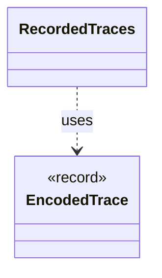

# `RecordedTraces`

`io.github.tlaplus.hardening.workflow.tool` · class · other · [source](https://github.com/tlaplus/model-checker-hardening/blob/218ef666053227c924e8c5067ad85b75f69870ca/src/main/java/io/github/tlaplus/hardening/workflow/tool/RecordedTraces.java#L15) · module [workflow](../modules/workflow.md)

Turns the trace a checker worker recorded into what its stage stores (ADR 0034 §5): read at the types of the module's variables, then encoded canonically.

**Decisions:** [ADR 0034: Replaying counterexamples as corpus inputs](https://github.com/tlaplus/model-checker-hardening/blob/218ef666053227c924e8c5067ad85b75f69870ca/docs/decisions/0034-counterexample-replay.md)

The diagram draws 1 of 5 relations; the table lists them all.

| Direction | Relation | Type | Summary |
|---|---|---|---|
| → | uses | [EncodedTrace](io.github.tlaplus.hardening.corpus.EncodedTrace.md) | The counterexample a checker stage recorded (ADR 0034 §5), stored under ` stages.&lt;checker&gt;.trace`. |
| → | depends | [ItfTraces](io.github.tlaplus.hardening.gen.trace.ItfTraces.md) | Reads a counterexample that a checker worker recorded (ADR 0034 §5) into a canonical `Trace`. |
| → | depends | [Trace](io.github.tlaplus.hardening.gen.trace.Trace.md) | The states of one recorded counterexample and what its last state claims (ADR 0034 §1, §2). |
| → | depends | [TracePayload](io.github.tlaplus.hardening.gen.trace.TracePayload.md) | The payload of a `trace` input (ADR 0034 §2), a CBOR array in deterministic encoding: |
| ← | depends | [ToolStage](io.github.tlaplus.hardening.workflow.tool.ToolStage.md) | One stage that runs an external tool over corpus entries: the parser, TLC, or Apalache. |
