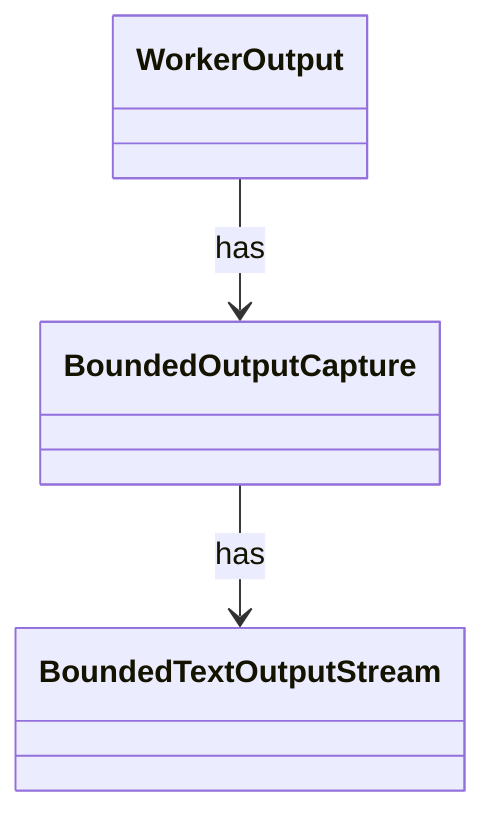

# `BoundedOutputCapture`

`io.github.tlaplus.hardening.workflow.worker` · class · other · [source](https://github.com/tlaplus/model-checker-hardening/blob/918f7db91890f302587d25c76dc7ac189db3d023/src/main/java/io/github/tlaplus/hardening/workflow/worker/BoundedOutputCapture.java#L9) · module [workflow](../modules/workflow.md)

Continuously drains a process stream while retaining only a bounded prefix.

The diagram draws 2 of 3 relations; the table lists them all.

| Direction | Relation | Type | Summary |
|---|---|---|---|
| → | has | [BoundedTextOutputStream](io.github.tlaplus.hardening.workflow.worker.BoundedTextOutputStream.md) | Retains a bounded UTF-8 byte prefix while discarding subsequent output. |
| ← | has | [WorkerOutput](io.github.tlaplus.hardening.workflow.worker.WorkerOutput.md) | Everything a child process says outside the control channel, and the scratch tree it says it in. |
| ← | depends | [OneShotTool](io.github.tlaplus.hardening.workflow.worker.OneShotTool.md) | A finite CLI invocation, unlike protocol workers which serve a sequence of per-input requests. |
