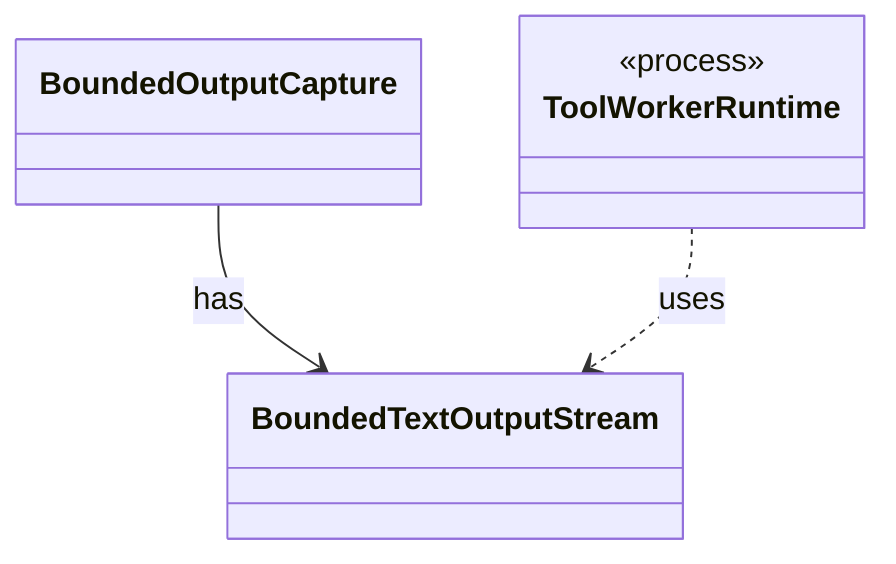

# `BoundedTextOutputStream`

`io.github.tlaplus.hardening.workflow.worker` · class · other · [source](https://github.com/tlaplus/model-checker-hardening/blob/5b16596dd480095d323ac67ff0f85eb85227b4b5/src/main/java/io/github/tlaplus/hardening/workflow/worker/BoundedTextOutputStream.java#L10) · module [workflow](../modules/workflow.md)

Retains a bounded UTF-8 byte prefix while discarding subsequent output.

The diagram draws 2 of 7 relations; the table lists them all.

| Direction | Relation | Type | Summary |
|---|---|---|---|
| ← | has | [BoundedOutputCapture](io.github.tlaplus.hardening.workflow.worker.BoundedOutputCapture.md) | Continuously drains a process stream while retaining only a bounded prefix. |
| ← | uses | [ToolWorkerRuntime](io.github.tlaplus.hardening.workflow.worker.ToolWorkerRuntime.md) | The part of a child worker that is the same for every tool: report an escaped failure by exiting non-zero, announce itself to the parent, serve inputs until the parent stops asking, write each input where the tool reads it, and keep a bounded record of what the tool printed. |
| → | depends | [Preconditions](io.github.tlaplus.hardening.common.Preconditions.md) | Shared validation of method and constructor arguments. |
| ← | depends | [ApalacheWorkerMain](io.github.tlaplus.hardening.workflow.apalache.ApalacheWorkerMain.md) | Persistent child process that invokes Apalache's `Tool.run` sequentially. |
| ← | depends | [ParserWorkerMain](io.github.tlaplus.hardening.workflow.parser.ParserWorkerMain.md) | Child-process entry point for persistent isolated SANY requests. |
| ← | depends | [TlcWorkerMain](io.github.tlaplus.hardening.workflow.tlc.TlcWorkerMain.md) | One-shot TLC child process. |
| ← | depends | [ToolThreadStacks](io.github.tlaplus.hardening.workflow.worker.ToolThreadStacks.md) | The stacks of the threads a stopped worker was working on, for the diagnostic of a timeout (ADR 0021). |
