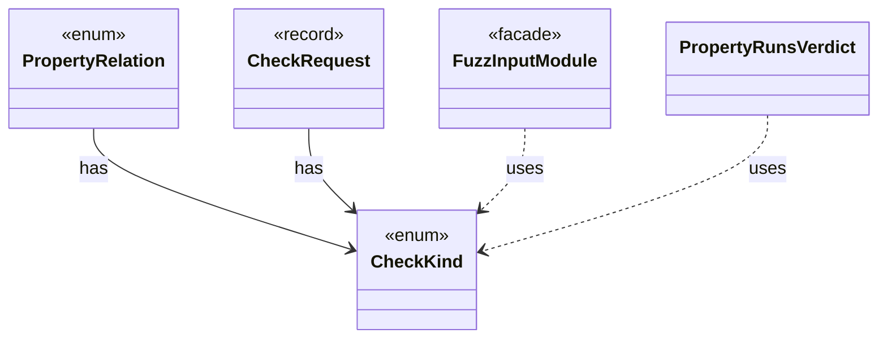

# `CheckKind`

`io.github.tlaplus.hardening.workflow.worker` · enum · other · [source](https://github.com/tlaplus/model-checker-hardening/blob/39531345378d8db5a429220f50aed4254ea670fb/src/main/java/io/github/tlaplus/hardening/workflow/worker/CheckKind.java#L16) · module [workflow](../modules/workflow.md)

What one checker invocation checks in an assembled module: which side's specification it explores, and whether it checks the invariant, the action invariant of a metamorphic module and a temporal property.

**Decisions:** [ADR 0027: Metamorphic testing of temporal properties](https://github.com/tlaplus/model-checker-hardening/blob/39531345378d8db5a429220f50aed4254ea670fb/docs/decisions/0027-temporal-metamorphic-testing.md), [ADR 0029: Apalache in temporal metamorphic testing](https://github.com/tlaplus/model-checker-hardening/blob/39531345378d8db5a429220f50aed4254ea670fb/docs/decisions/0029-apalache-temporal-metamorphic-testing.md)

The diagram draws 4 of 12 relations; the table lists them all.

| Direction | Relation | Type | Summary |
|---|---|---|---|
| ← | has | [PropertyRelation](io.github.tlaplus.hardening.workflow.spec.PropertyRelation.md) | How the relation module of a metamorphic pair of modules treats their properties and fairness. |
| ← | has | [CheckRequest](io.github.tlaplus.hardening.workflow.worker.CheckRequest.md) | What a checker is asked about one assembled module. |
| ← | uses | [FuzzInputModule](io.github.tlaplus.hardening.workflow.spec.FuzzInputModule.md) | Assembles the module checked by the parser and model-checker stages. |
| ← | uses | [PropertyRunsVerdict](io.github.tlaplus.hardening.workflow.tool.PropertyRunsVerdict.md) | Folds the relation run of a metamorphic module and its two property runs into the one outcome of a checker stage (ADR 0027 §4, ADR 0029 §1). |
| ← | depends | [DecodedInputRenderer](io.github.tlaplus.hardening.cli.DecodedInputRenderer.md) | Renders a decoded input independently of picocli command wiring. |
| ← | depends | [ApalacheArguments](io.github.tlaplus.hardening.workflow.apalache.ApalacheArguments.md) | The Apalache command line for one checked module. |
| ← | depends | [ApalacheCheckerBackend](io.github.tlaplus.hardening.workflow.apalache.ApalacheCheckerBackend.md) | Adapts persistent Apalache tool workers to the shared tool stage. |
| ← | depends | [ApalacheWorkerMain](io.github.tlaplus.hardening.workflow.apalache.ApalacheWorkerMain.md) | Persistent child process that invokes Apalache's `Tool.run` sequentially. |
| ← | depends | [SpecArtifact](io.github.tlaplus.hardening.workflow.spec.SpecArtifact.md) | One assembled module, what its checkers are asked about it, and what its decoder produced. |
| ← | depends | [TlcCheckerBackend](io.github.tlaplus.hardening.workflow.tlc.TlcCheckerBackend.md) | Adapts fresh isolated TLC invocations to the shared tool stage. |
| ← | depends | [TlcConfiguration](io.github.tlaplus.hardening.workflow.tlc.TlcConfiguration.md) | The TLC configuration file for one checked module. |
| ← | depends | [ToolWorkerProtocol](io.github.tlaplus.hardening.workflow.worker.ToolWorkerProtocol.md) | Binary framing shared by isolated parser and model-checker workers. |
