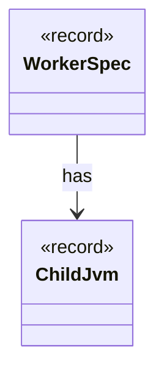

# `ChildJvm`

`io.github.tlaplus.hardening.workflow.worker` · record · other · [source](https://github.com/tlaplus/model-checker-hardening/blob/0b7c167b636088dd43d36713d157e22f7ebd4f79/src/main/java/io/github/tlaplus/hardening/workflow/worker/ChildJvm.java#L21) · module [workflow](../modules/workflow.md)

The resources and options of one child JVM.

The diagram draws 1 of 6 relations; the table lists them all.

| Direction | Relation | Type | Summary |
|---|---|---|---|
| ← | has | [WorkerSpec](io.github.tlaplus.hardening.workflow.worker.WorkerSpec.md) | How to launch one isolated tool worker: where it may write, how long it may take to come up, which class it runs, what goes in front of this JVM's class path, the child JVM it runs in, and what to call it in diagnostics. |
| → | depends | [Preconditions](io.github.tlaplus.hardening.common.Preconditions.md) | Shared validation of method and constructor arguments. |
| ← | depends | [ApalacheProcess](io.github.tlaplus.hardening.workflow.apalache.ApalacheProcess.md) | Starts one persistent isolated Apalache JVM, which serves inputs until a crash retires it. |
| ← | depends | [ParserProcess](io.github.tlaplus.hardening.workflow.parser.ParserProcess.md) | Starts one persistent isolated SANY JVM; the common process handle owns requests and closing. |
| ← | depends | [TlcProcess](io.github.tlaplus.hardening.workflow.tlc.TlcProcess.md) | Runs one TLC request in a fresh isolated JVM. |
| ← | depends | [WorkerLaunch](io.github.tlaplus.hardening.workflow.worker.WorkerLaunch.md) | Brings one isolated worker up: private scratch storage, a private loopback listener, the child JVM, and an authenticated control connection. |
