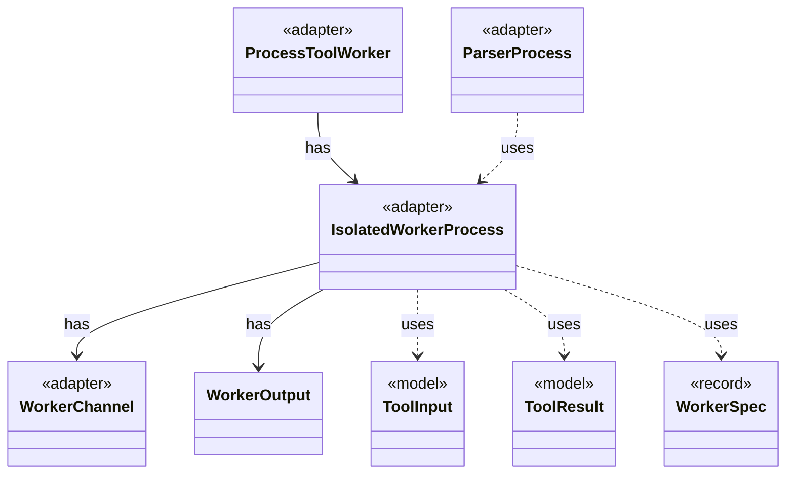

# `IsolatedWorkerProcess`

`io.github.tlaplus.hardening.workflow.worker` · class · adapter · key · [source](https://github.com/tlaplus/model-checker-hardening/blob/12d0a3fd62c72add470e6ee06490c4e3591f490e/src/main/java/io/github/tlaplus/hardening/workflow/worker/IsolatedWorkerProcess.java#L29) · module [workflow](../modules/workflow.md)

Parent-side supervisor for one isolated Java tool worker.

The diagram draws 7 of 16 relations; the table lists them all.

| Direction | Relation | Type | Summary |
|---|---|---|---|
| → | has | [WorkerChannel](io.github.tlaplus.hardening.workflow.worker.WorkerChannel.md) | The parent's end of one worker's control channel: message framing, and the deadline every read runs under. |
| → | has | [WorkerOutput](io.github.tlaplus.hardening.workflow.worker.WorkerOutput.md) | Everything a child process says outside the control channel, and the scratch tree it says it in. |
| ← | has | [ProcessToolWorker](io.github.tlaplus.hardening.workflow.tool.ProcessToolWorker.md) | A tool worker served by one isolated child process until a crash verdict retires it. |
| → | uses | [ToolInput](io.github.tlaplus.hardening.workflow.worker.ToolInput.md) | One rendered specification and what the receiving checker is asked about it. |
| → | uses | [ToolResult](io.github.tlaplus.hardening.workflow.worker.ToolResult.md) | One request result returned by an isolated tool worker. |
| → | uses | [WorkerSpec](io.github.tlaplus.hardening.workflow.worker.WorkerSpec.md) | How to launch one isolated tool worker: where it may write, how long it may take to come up, which class it runs, what goes in front of this JVM's class path, the child JVM it runs in, and what to call it in diagnostics. |
| ← | uses | [ParserProcess](io.github.tlaplus.hardening.workflow.parser.ParserProcess.md) | Starts one persistent isolated SANY JVM; the common process handle owns requests and closing. |
| → | depends | [Diagnostics](io.github.tlaplus.hardening.common.Diagnostics.md) | Human-readable diagnostic formatting for failures. |
| → | depends | [WorkflowException](io.github.tlaplus.hardening.workflow.WorkflowException.md) | Reports an infrastructure or lifecycle failure in a fuzzing workflow. |
| → | depends | [CheckRequest](io.github.tlaplus.hardening.workflow.worker.CheckRequest.md) | What a checker is asked about one assembled module. |
| → | depends | [StageOutcome](io.github.tlaplus.hardening.workflow.worker.StageOutcome.md) | Common result of processing one input in a checking stage. |
| → | depends | [ToolWorkerProtocol](io.github.tlaplus.hardening.workflow.worker.ToolWorkerProtocol.md) | Binary framing shared by isolated parser and model-checker workers. |
| → | depends | [WorkerLaunch](io.github.tlaplus.hardening.workflow.worker.WorkerLaunch.md) | Brings one isolated worker up: private scratch storage, a private loopback listener, the child JVM, and an authenticated control connection. |
| ← | depends | [ApalacheProcess](io.github.tlaplus.hardening.workflow.apalache.ApalacheProcess.md) | Starts one persistent isolated Apalache JVM, which serves inputs until a crash retires it. |
| ← | depends | [ParserBackend](io.github.tlaplus.hardening.workflow.parser.ParserBackend.md) | Runs SANY in persistent isolated JVMs, one per stage worker, each replaced after a crash. |
| ← | depends | [TlcProcess](io.github.tlaplus.hardening.workflow.tlc.TlcProcess.md) | Runs one TLC request in a fresh isolated JVM. |
