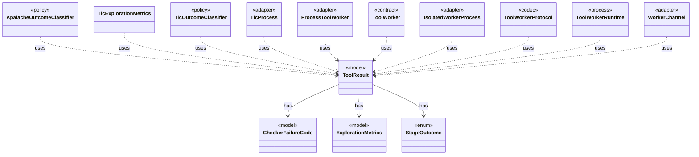

# `ToolResult`

`io.github.tlaplus.hardening.workflow.worker` · record · model · key · [source](https://github.com/tlaplus/model-checker-hardening/blob/4c5cb469fa5cdcada2cd5740bce130b825b35343/src/main/java/io/github/tlaplus/hardening/workflow/worker/ToolResult.java#L19) · module [workflow](../modules/workflow.md)

One request result returned by an isolated tool worker.

The diagram draws 13 of 23 relations; the table lists them all.

| Direction | Relation | Type | Summary |
|---|---|---|---|
| → | has | [CheckerFailureCode](io.github.tlaplus.hardening.checker.CheckerFailureCode.md) | Stable failure codes shared by model-checker stages. |
| → | has | [ExplorationMetrics](io.github.tlaplus.hardening.checker.ExplorationMetrics.md) | What a model checker explored to reach its verdict, as ADR 0008 defines it. |
| → | has | [StageOutcome](io.github.tlaplus.hardening.workflow.worker.StageOutcome.md) | Common result of processing one input in a checking stage. |
| ← | uses | [ApalacheOutcomeClassifier](io.github.tlaplus.hardening.workflow.apalache.ApalacheOutcomeClassifier.md) | Maps Apalache tool exit statuses to shared workflow outcomes. |
| ← | uses | [TlcExplorationMetrics](io.github.tlaplus.hardening.workflow.tlc.TlcExplorationMetrics.md) | Measures one TLC run and attaches the result to its classified outcome (ADR 0008). |
| ← | uses | [TlcOutcomeClassifier](io.github.tlaplus.hardening.workflow.tlc.TlcOutcomeClassifier.md) | Maps TLC's internal error constants to workflow outcomes. |
| ← | uses | [TlcProcess](io.github.tlaplus.hardening.workflow.tlc.TlcProcess.md) | Runs one TLC request in a fresh isolated JVM. |
| ← | uses | [ProcessToolWorker](io.github.tlaplus.hardening.workflow.tool.ProcessToolWorker.md) | A tool worker served by one isolated child process until a crash verdict retires it. |
| ← | uses | [ToolWorker](io.github.tlaplus.hardening.workflow.tool.ToolWorker.md) | Worker-local tool state used for one or more sequential inputs. |
| ← | uses | [IsolatedWorkerProcess](io.github.tlaplus.hardening.workflow.worker.IsolatedWorkerProcess.md) | Parent-side supervisor for one isolated Java tool worker. |
| ← | uses | [ToolWorkerProtocol](io.github.tlaplus.hardening.workflow.worker.ToolWorkerProtocol.md) | Binary framing shared by isolated parser and model-checker workers. |
| ← | uses | [ToolWorkerRuntime](io.github.tlaplus.hardening.workflow.worker.ToolWorkerRuntime.md) | The part of a child worker that is the same for every tool: report an escaped failure by exiting non-zero, announce itself to the parent, serve inputs until the parent stops asking, write each input where the tool reads it, and keep a bounded record of what the tool printed. |
| ← | uses | [WorkerChannel](io.github.tlaplus.hardening.workflow.worker.WorkerChannel.md) | The parent's end of one worker's control channel: message framing, and the deadline every read runs under. |
| → | depends | [Diagnostics](io.github.tlaplus.hardening.common.Diagnostics.md) | Human-readable diagnostic formatting for failures. |
| → | depends | [Preconditions](io.github.tlaplus.hardening.common.Preconditions.md) | Shared validation of method and constructor arguments. |
| → | depends | [WorkerDiagnostics](io.github.tlaplus.hardening.workflow.worker.WorkerDiagnostics.md) | Diagnostic formatting shared by isolated tool entry points. |
| ← | depends | [MetamorphicShrinker](io.github.tlaplus.hardening.workflow.MetamorphicShrinker.md) | Reduces a metamorphic counterexample for triage (ADR 0016 §8). |
| ← | depends | [ApalacheWorkerMain](io.github.tlaplus.hardening.workflow.apalache.ApalacheWorkerMain.md) | Persistent child process that invokes Apalache's `Tool.run` sequentially. |
| ← | depends | [LibrarySourceProbe](io.github.tlaplus.hardening.workflow.library.LibrarySourceProbe.md) | Parses every source alias of a prepared library once, with the classpath the parser and TLC workers receive (ADR 0015). |
| ← | depends | [ParserWorkerMain](io.github.tlaplus.hardening.workflow.parser.ParserWorkerMain.md) | Child-process entry point for persistent isolated SANY requests. |
| ← | depends | [TlcCheckerBackend](io.github.tlaplus.hardening.workflow.tlc.TlcCheckerBackend.md) | Adapts fresh isolated TLC invocations to the shared tool stage. |
| ← | depends | [TlcWorkerMain](io.github.tlaplus.hardening.workflow.tlc.TlcWorkerMain.md) | One-shot TLC child process. |
| ← | depends | [ToolStage](io.github.tlaplus.hardening.workflow.tool.ToolStage.md) | One stage that runs an external tool over corpus entries: the parser, TLC, or Apalache. |
