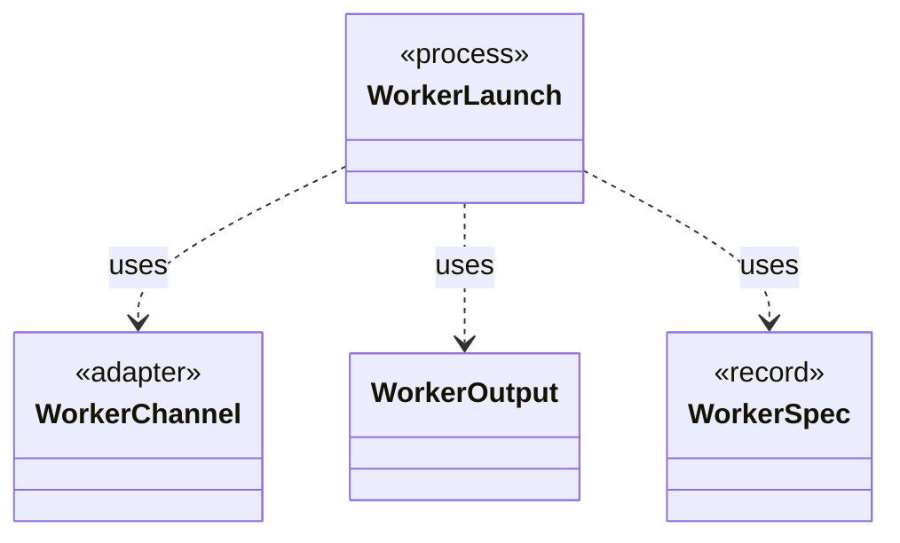

# `WorkerLaunch`

`io.github.tlaplus.hardening.workflow.worker` · class · process · key · [source](https://github.com/tlaplus/model-checker-hardening/blob/0b7c167b636088dd43d36713d157e22f7ebd4f79/src/main/java/io/github/tlaplus/hardening/workflow/worker/WorkerLaunch.java#L38) · module [workflow](../modules/workflow.md)

Brings one isolated worker up: private scratch storage, a private loopback listener, the child JVM, and an authenticated control connection.

The diagram draws 3 of 11 relations; the table lists them all.

| Direction | Relation | Type | Summary |
|---|---|---|---|
| → | uses | [WorkerChannel](io.github.tlaplus.hardening.workflow.worker.WorkerChannel.md) | The parent's end of one worker's control channel: message framing, and the deadline every read runs under. |
| → | uses | [WorkerOutput](io.github.tlaplus.hardening.workflow.worker.WorkerOutput.md) | Everything a child process says outside the control channel, and the scratch tree it says it in. |
| → | uses | [WorkerSpec](io.github.tlaplus.hardening.workflow.worker.WorkerSpec.md) | How to launch one isolated tool worker: where it may write, how long it may take to come up, which class it runs, what goes in front of this JVM's class path, the child JVM it runs in, and what to call it in diagnostics. |
| → | depends | [Cleanup](io.github.tlaplus.hardening.common.Cleanup.md) | Best-effort I/O cleanup that retains the original failure and its suppressed diagnostics. |
| → | depends | [FileTrees](io.github.tlaplus.hardening.common.FileTrees.md) | File-tree operations shared by the corpus and by isolated worker processes. |
| → | depends | [ThrowingRunnable](io.github.tlaplus.hardening.common.ThrowingRunnable.md) | An operation that takes no value and may fail with a checked exception. |
| → | depends | [WorkflowException](io.github.tlaplus.hardening.workflow.WorkflowException.md) | Reports an infrastructure or lifecycle failure in a fuzzing workflow. |
| → | depends | [ChildJvm](io.github.tlaplus.hardening.workflow.worker.ChildJvm.md) | The resources and options of one child JVM. |
| → | depends | [JavaLaunch](io.github.tlaplus.hardening.workflow.worker.JavaLaunch.md) | How this project spells a child JVM launch, so every caller spells it the same way. |
| ← | depends | [IsolatedWorkerProcess](io.github.tlaplus.hardening.workflow.worker.IsolatedWorkerProcess.md) | Parent-side supervisor for one isolated Java tool worker. |
| ← | depends | [OneShotTool](io.github.tlaplus.hardening.workflow.worker.OneShotTool.md) | A finite CLI invocation, unlike protocol workers which serve a sequence of per-input requests. |
