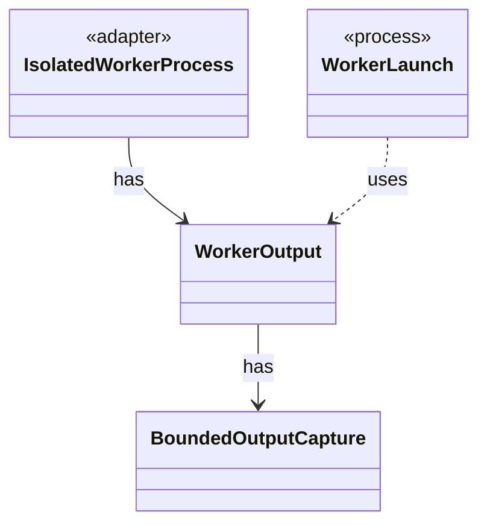

# `WorkerOutput`

`io.github.tlaplus.hardening.workflow.worker` · class · other · [source](https://github.com/tlaplus/model-checker-hardening/blob/4c5cb469fa5cdcada2cd5740bce130b825b35343/src/main/java/io/github/tlaplus/hardening/workflow/worker/WorkerOutput.java#L15) · module [workflow](../modules/workflow.md)

Everything a child process says outside the control channel, and the scratch tree it says it in.

The diagram draws 3 of 7 relations; the table lists them all.

| Direction | Relation | Type | Summary |
|---|---|---|---|
| → | has | [BoundedOutputCapture](io.github.tlaplus.hardening.workflow.worker.BoundedOutputCapture.md) | Continuously drains a process stream while retaining only a bounded prefix. |
| ← | has | [IsolatedWorkerProcess](io.github.tlaplus.hardening.workflow.worker.IsolatedWorkerProcess.md) | Parent-side supervisor for one isolated Java tool worker. |
| ← | uses | [WorkerLaunch](io.github.tlaplus.hardening.workflow.worker.WorkerLaunch.md) | Brings one isolated worker up: private scratch storage, a private loopback listener, the child JVM, and an authenticated control connection. |
| → | depends | [FileTrees](io.github.tlaplus.hardening.common.FileTrees.md) | File-tree operations shared by the corpus and by isolated worker processes. |
| → | depends | [ToolThreadStacks](io.github.tlaplus.hardening.workflow.worker.ToolThreadStacks.md) | The stacks of the threads a stopped worker was working on, for the diagnostic of a timeout (ADR 0021). |
| → | depends | [ToolWorkerProtocol](io.github.tlaplus.hardening.workflow.worker.ToolWorkerProtocol.md) | Binary framing shared by isolated parser and model-checker workers. |
| → | depends | [WorkerDiagnostics](io.github.tlaplus.hardening.workflow.worker.WorkerDiagnostics.md) | Diagnostic formatting shared by isolated tool entry points. |
