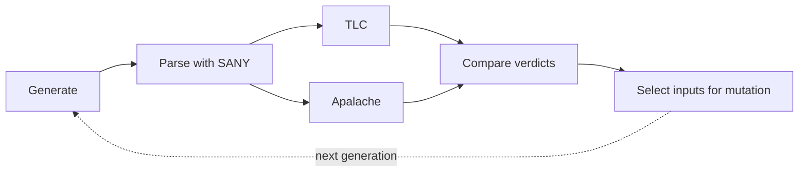

# FuzzTLA

FuzzTLA tests the TLA+ model checkers [TLC](https://github.com/tlaplus/tlaplus)
and [Apalache](https://github.com/apalache-mc/apalache). It generates random
TLA+ specifications, checks each one with both tools, and keeps every
specification on which they disagree, fail or crash. A campaign therefore finds
defects in either checker and documents where their semantics differ.

!!! note "Under active development"
    Input and output formats, configuration keys and corpus layouts may change without
    notice. Initialize a new corpus after upgrading FuzzTLA.

## How it works

1. **Generate.** FuzzTLA turns random bytes into a well-typed TLA+ module.
   The same bytes always produce the same module.
2. **Parse.** SANY, the TLA+ parser, must accept the module.
3. **Check.** TLC and Apalache check the module with the same `Init`, `Next` and
   invariant, independently and in parallel.
4. **Compare.** If the verdicts differ, for example a pass against a counterexample,
   the entry is a *disagreement*.
5. **Select and mutate.** Agreeing entries that exercise the checkers well seed the
   next generation of inputs.

Every input, verdict and diagnostic is stored in a *corpus*, a directory you can resume,
inspect, query and report on.

## Where to start

- [Getting started](getting-started.md): build FuzzTLA and run your first campaign.
- [The corpus](corpus.md): what a campaign stores and what the verdicts mean.
- [Running campaigns](running.md) and [Configuration](configuration.md): control
  what is generated and how the checkers are run.
- [Inspecting a corpus](inspecting.md): turn a disagreement into a TLA+
  module you can rerun, and classify crashes against known issues.
- [Results](results.md): the defects and conformance differences found so far.
