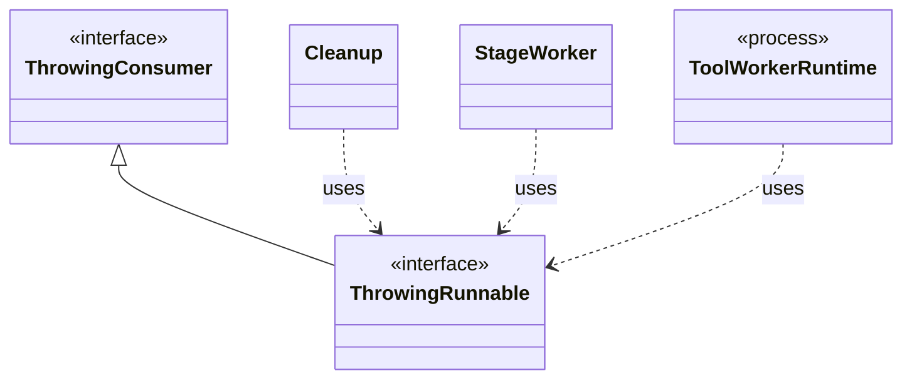

# `ThrowingRunnable`

`io.github.tlaplus.hardening.common` · interface · other · [source](https://github.com/tlaplus/model-checker-hardening/blob/47dd62c3064b76d8140ecbc017a45de80d885015/src/main/java/io/github/tlaplus/hardening/common/ThrowingRunnable.java#L9) · module [common](../modules/common.md)

An operation that takes no value and may fail with a checked exception.

The diagram draws 4 of 14 relations; the table lists them all.

| Direction | Relation | Type | Summary |
|---|---|---|---|
| → | extends | [ThrowingConsumer](io.github.tlaplus.hardening.common.ThrowingConsumer.md) | An operation on one value that may fail with a checked exception. |
| ← | uses | [Cleanup](io.github.tlaplus.hardening.common.Cleanup.md) | Best-effort I/O cleanup that retains the original failure and its suppressed diagnostics. |
| ← | uses | [StageWorker](io.github.tlaplus.hardening.workflow.execution.StageWorker.md) | Runs one stage worker, turning its interruption or failure into shared stop state. |
| ← | uses | [ToolWorkerRuntime](io.github.tlaplus.hardening.workflow.worker.ToolWorkerRuntime.md) | The part of a child worker that is the same for every tool: report an escaped failure by exiting non-zero, announce itself to the parent, serve inputs until the parent stops asking, write each input where the tool reads it, and keep a bounded record of what the tool printed. |
| ← | depends | [StageScratch](io.github.tlaplus.hardening.corpus.StageScratch.md) | Corpus-owned transient storage for one stage during one workflow invocation. |
| ← | depends | [CorpusExport](io.github.tlaplus.hardening.database.CorpusExport.md) | Exports a corpus to a new SQLite database, as ADR 0009 defines it. |
| ← | depends | [AggregatorStage](io.github.tlaplus.hardening.workflow.aggregator.AggregatorStage.md) | Joins completed TLC and Apalache results with one in-process worker. |
| ← | depends | [ApalacheWorkerMain](io.github.tlaplus.hardening.workflow.apalache.ApalacheWorkerMain.md) | Persistent child process that invokes Apalache's `Tool.run` sequentially. |
| ← | depends | [InputStage](io.github.tlaplus.hardening.workflow.input.InputStage.md) | Concurrent input stage: admits reserved target ranges from adjacent generations. |
| ← | depends | [ParserWorkerMain](io.github.tlaplus.hardening.workflow.parser.ParserWorkerMain.md) | Child-process entry point for persistent isolated SANY requests. |
| ← | depends | [TlcWorkerMain](io.github.tlaplus.hardening.workflow.tlc.TlcWorkerMain.md) | One-shot TLC child process. |
| ← | depends | [ToolStage](io.github.tlaplus.hardening.workflow.tool.ToolStage.md) | One stage that runs an external tool over corpus entries: the parser, TLC, or Apalache. |
| ← | depends | [ToolWorkerConnection](io.github.tlaplus.hardening.workflow.worker.ToolWorkerConnection.md) | Child-side connection to the parent's private worker-protocol listener. |
| ← | depends | [WorkerLaunch](io.github.tlaplus.hardening.workflow.worker.WorkerLaunch.md) | Brings one isolated worker up: private scratch storage, a private loopback listener, the child JVM, and an authenticated control connection. |
