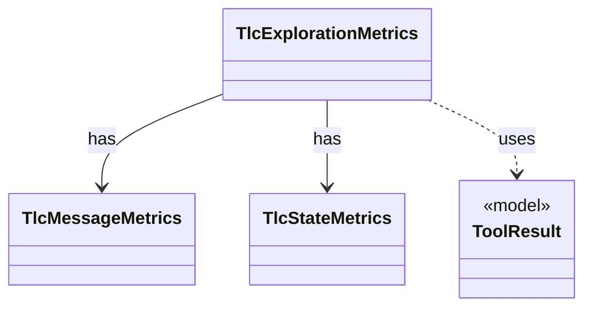

# `TlcExplorationMetrics`

`io.github.tlaplus.hardening.workflow.tlc` · class · other · [source](https://github.com/tlaplus/model-checker-hardening/blob/47dd62c3064b76d8140ecbc017a45de80d885015/src/main/java/io/github/tlaplus/hardening/workflow/tlc/TlcExplorationMetrics.java#L20) · module [workflow](../modules/workflow.md)

Measures one TLC run and attaches the result to its classified outcome (ADR 0008).

**Decisions:** [ADR 0008: Exploration metrics](https://github.com/tlaplus/model-checker-hardening/blob/47dd62c3064b76d8140ecbc017a45de80d885015/docs/decisions/0008-exploration-metrics.md)

The diagram draws 3 of 9 relations; the table lists them all.

| Direction | Relation | Type | Summary |
|---|---|---|---|
| → | has | [TlcMessageMetrics](io.github.tlaplus.hardening.workflow.tlc.TlcMessageMetrics.md) | Follows the messages TLC prints, which say when its initial states are complete and which states its error trace consists of. |
| → | has | [TlcStateMetrics](io.github.tlaplus.hardening.workflow.tlc.TlcStateMetrics.md) | Measures the state graph TLC explores, through the state-writer callbacks TLC makes for every initial state and every generated transition. |
| → | uses | [ToolResult](io.github.tlaplus.hardening.workflow.worker.ToolResult.md) | One request result returned by an isolated tool worker. |
| → | depends | [ExplorationCount](io.github.tlaplus.hardening.checker.ExplorationCount.md) | A counted exploration metric. |
| → | depends | [ExplorationMetrics](io.github.tlaplus.hardening.checker.ExplorationMetrics.md) | What a model checker explored to reach its verdict, as ADR 0008 defines it. |
| → | depends | [ExplorationPhase](io.github.tlaplus.hardening.checker.ExplorationPhase.md) | How far a model checker got before its verdict was fixed. |
| → | depends | [GeneratedSpec](io.github.tlaplus.hardening.gen.GeneratedSpec.md) | The declarations one generated module consists of. |
| → | depends | [StageOutcome](io.github.tlaplus.hardening.workflow.worker.StageOutcome.md) | Common result of processing one input in a checking stage. |
| ← | depends | [TlcWorkerMain](io.github.tlaplus.hardening.workflow.tlc.TlcWorkerMain.md) | One-shot TLC child process. |
